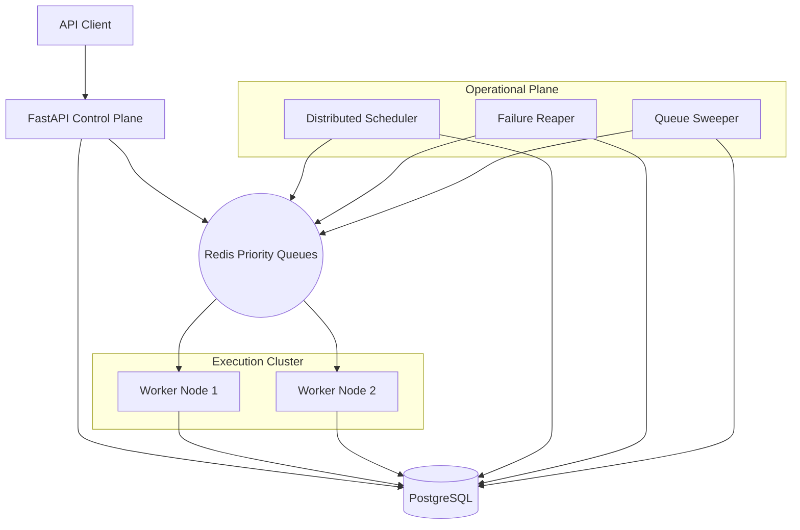

# 🚀 Distributed Task Engine

A production-grade, distributed task orchestration platform built with **Python**, **FastAPI**, **PostgreSQL**, and **Redis**. 

Designed for high reliability and operational visibility, this engine handles everything from immediate job execution to complex scheduled workloads with tiered priority and hard failure guarantees.

---

## 🏗️ System Architecture



---

## 🔥 Key Engineering Features

### 🛡️ Reliability & Correctness
*   **Atomic Claiming**: Uses `SELECT FOR UPDATE SKIP LOCKED` to ensure zero-collision task acquisition across multiple nodes.
*   **Process-Isolated Execution**: Tasks run in isolated subprocesses with **Hard Timeouts**, ensuring "Poison Pill" tasks cannot hang worker threads.
*   **Idempotent Submission**: Fingerprint-validated `idempotency_key` support prevents duplicate task creation while ensuring intent integrity.
*   **At-Least-Once Guarantee**: Robust heartbeat-based liveness tracking with automatic **Reaper recovery** for crashed worker nodes.

### 📊 Observability & Operations
*   **Structured Logging**: Production-ready JSON logging for seamless ELK/Splunk integration.
*   **Prometheus Metrics**: Built-in instrumentation for throughput, latency, and failure rates.
*   **Tiered Priority**: Multi-queue architecture with **Atomic Lua Dispatching** ensures High-Priority workloads preempt background tasks.
*   **Resilient Backoff**: Exponential backoff with **Jitter** to prevent thundering herd effects during system recovery.

---

## 🚀 Quick Start

Launch the entire distributed cluster with Docker Compose:

```bash
docker-compose up -d --build
```

The cluster includes:
- **Operator Dashboard**: `http://localhost:8000/dashboard` (Premium real-time UI for monitoring, search, task submission, and recovery)
- **API**: `http://localhost:8000`
- **Metrics**: `http://localhost:8000/metrics`
- **Workers**: 2x instances (scale with `docker-compose up -d --scale worker=5`)

---

## 📖 Documentation
- [Architecture Deep Dive](ARCHITECTURE.md) - How the engine works under the hood.
